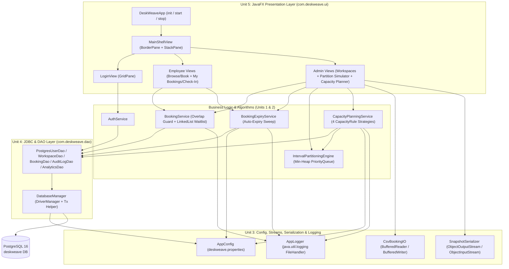
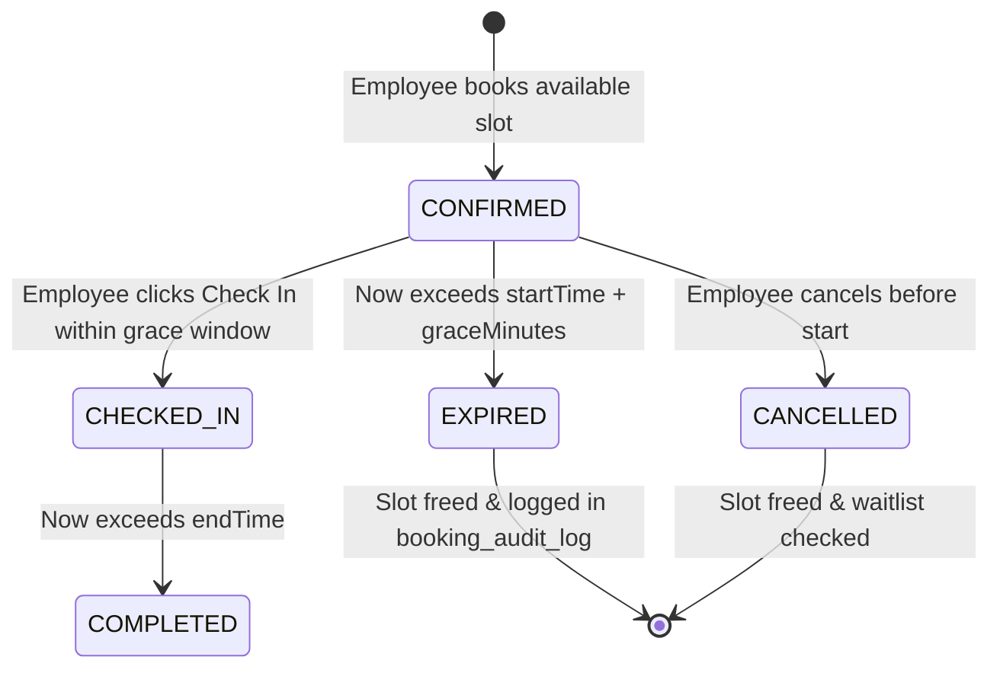
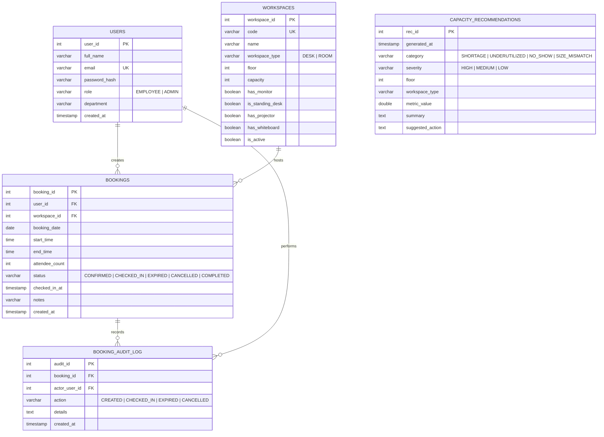
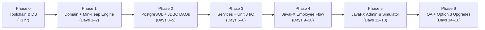

# DeskWeave — Smart Workspace Booking & Capacity Planning Platform
**Implementation & Build Plan (UCS553: Enterprise Web Application)**

---

## 1. Project Overview & Goals

**DeskWeave** is a modular, database-driven desktop application built with **Java 21 + OpenJFX 21 + Maven + JDBC + PostgreSQL 16** (using **Pure JavaFX + CSS** for the UI). Employees can search, filter, and reserve desks and meeting rooms, while facilities teams get real capacity intelligence instead of a plain scheduling grid.

- **Core Intelligence**: A greedy **Interval Partitioning Engine** (min-heap `PriorityQueue`) computes the minimum number of physical rooms required to honor a set of requests and flags overflow demand that cannot be accommodated.
- **Automated Hygiene**: An **Auto-Expiry & Check-In Manager** automatically releases unclaimed bookings after a configurable grace period inside atomic JDBC transactions.
- **Capacity Planning**: A pluggable **Capacity Planning Module** mines historical booking data across four strategy rules to recommend concrete space adjustments.
- **Delivery Strategy**: MVP-first sequential build (Phases 0–5) with a clean, zero-refactor upgrade path to rich Phase 2 / Option 3 visualizations (Phase 6).

---

## 2. Database Decision & Local Environment Setup

### Database Recommendation: PostgreSQL 16
**PostgreSQL 16** is the primary database for DeskWeave:
- **Enterprise & Viva Credibility**: Native `TIMESTAMP`, `CHECK` constraints, `GENERATED ALWAYS AS IDENTITY`, and row-level locking (`SELECT ... FOR UPDATE`) make Unit 4 JDBC Transaction Management and concurrency handling realistic.
- **Offline Reliability**: Running PostgreSQL locally via Homebrew or Docker ensures zero Wi-Fi dependency during grading/viva demos.
- **Local Environment Status**: On this Apple Silicon (`arm64`) Mac, `postgresql@16` (`/opt/homebrew/opt/postgresql@16/bin/psql`) and `docker` (`/usr/local/bin/docker`) are already installed.
- **Fast Automated Tests**: Automated JUnit 5 DAO tests run against **H2 in PostgreSQL compatibility mode** (`jdbc:h2:mem:deskweave;MODE=PostgreSQL`), so `mvn test` passes in seconds even if the local Postgres daemon is stopped.

### Missing Local Tooling Setup (Step 0)
`/Users/krishnasalgotra/JAVA_PROJECT` starts empty and `java` / `mvn` are not on `PATH` yet. Install Temurin JDK 21 and Maven via Homebrew before starting Phase 0:

```bash
brew install --cask temurin@21
brew install maven
```

Start PostgreSQL 16 and create the database:

```bash
brew services start postgresql@16
createdb deskweave
```

---

## 3. UCS553 Syllabus-to-Feature Coverage Matrix

Every topic across **Units 1–5** of the UCS553 syllabus is showcased authentically in DeskWeave:

| Syllabus Unit | Required Concepts | Exact DeskWeave Implementation |
| :--- | :--- | :--- |
| **Unit 1: Java Foundations & OOP** | Packages, OOP (classes, objects, abstract classes, interfaces), access modifiers, `static` vs instance, coding conventions, Maven | `com.deskweave.*` packages; `abstract class Workspace` -> concrete `Desk` & `MeetingRoom`; interfaces `Bookable`, `GenericDao<T, ID>`, `CapacityRule`, `ReportExporter`; `private`/`protected` encapsulation + `static` constants & factories; Maven `pom.xml` with OpenJFX 21 |
| **Unit 2: Exceptions, Collections, Generics & Utilities** | Custom exception hierarchy, `ArrayList`, `LinkedList`, `HashSet`, `HashMap`, `PriorityQueue`, `Iterator`, `Comparator`, Generics, `Objects`, `Optional`, `Math`, `LocalDate/Time` | `DeskWeaveException` hierarchy (`BookingConflictException`, `InsufficientCapacityException`, `InvalidTimeSlotException`, `ResourceNotFoundException`, `AuthenticationException`, `DataAccessException`); **Min-heap `PriorityQueue` + custom `Comparator`** in Interval Partitioning; `LinkedList` waitlist queue; `HashMap` workspace/date index; `HashSet` flagged conflict IDs; `Iterator` during batch expiry cleanup; `GenericDao<T, ID>` & `PartitionResult<T>`; `Optional`, `Objects.requireNonNull`, `LocalDate`/`LocalTime`/`LocalDateTime`, `Math` |
| **Unit 3: File I/O, Serialization, Logging & Config** | Byte & character streams, file read/write, Object Serialization/Deserialization, `java.util.logging`, `.properties` configuration files | `config/deskweave.properties` loaded via `Properties`; **Character streams** (`BufferedReader`/`BufferedWriter`) for bulk CSV demand import & Capacity Report CSV export; **Byte streams + `Serializable`** (`ObjectOutputStream`/`ObjectInputStream`) to save/load `.dws` What-If Simulation Snapshots; `java.util.logging` `AppLogger` with Console + rotating `FileHandler` -> `logs/deskweave.log` |
| **Unit 4: JDBC & DAO Pattern** | JDBC architecture, RDBMS connection, `INSERT`/`SELECT`/`UPDATE`/`DELETE`, `PreparedStatement`, `ResultSet`, Transaction management (`commit`/`rollback`), DAO pattern | `DatabaseManager` + `GenericDao<T, ID>` + `PostgresUserDao`, `PostgresWorkspaceDao`, `PostgresBookingDao`, `PostgresAuditLogDao`, `CapacityAnalyticsDao`; parameterized `PreparedStatement` everywhere; **explicit JDBC transactions** (`setAutoCommit(false)`, `commit()`, `rollback()`) for atomic booking + audit write and atomic batch auto-expiry |
| **Unit 5: JavaFX GUI** | OpenJFX 21, `init()`/`start()`/`stop()`, Stage/Scene/Scene Graph, `BorderPane`, `HBox`, `VBox`, `GridPane`, `StackPane`, `Label`, `TextField`, `Button`, `TextArea`, `CheckBox`, `ComboBox`, `ListView`, `TableView`, Events & Listeners, Alerts/Dialogs | Pure JavaFX views + `deskweave.css`; `BorderPane` main shell, `StackPane` router + toast overlay, `GridPane` login & booking forms, `VBox`/`HBox` KPI cards & toolbars; `TableView` for workspaces/bookings/assignments/recommendations; `ListView` for overflow conflicts & waitlist; `Alert`/`Dialog` validation and confirmations |

---

## 4. System Architecture



---

## 5. Core Algorithms & Signature Modules

### A. Interval Partitioning Engine (`com.deskweave.engine.IntervalPartitioningEngine`)
Pure Java module with zero database or UI dependencies, making it 100% deterministic and unit-testable:

- **Input**: `List<BookingRequest> requests`, `List<Workspace> availableWorkspaces` (filtered by floor/type/capacity).
- **Algorithm ($O(n \log n)$ time, $O(n)$ space)**:
  1. Validate each `BookingRequest` (throw `InvalidTimeSlotException` if `!start.isBefore(end)`).
  2. Copy and sort requests by `(startTime ASC, endTime ASC)` using a custom `Comparator<BookingRequest>`.
  3. Maintain a **min-heap** ordered by earliest room release time:
     ```java
     PriorityQueue<RoomTrack> minHeap =
         new PriorityQueue<>(Comparator.comparing(RoomTrack::getCurrentEndTime));
     ```
  4. For each request `req`:
     - If `!minHeap.isEmpty()` and `!minHeap.peek().getCurrentEndTime().isAfter(req.getStartTime())` (touching intervals such as `09:00–10:00` and `10:00–11:00` safely share a room): poll the earliest `RoomTrack`, append `req`, update `currentEndTime = req.getEndTime()`, and re-insert via `offer`.
     - Otherwise, allocate a new `RoomTrack(++roomCount, req.getEndTime())`, append `req`, and insert into `minHeap`.
  5. **Physical Mapping & Overflow Flagging**:
     - `minRoomsNeeded = roomCount`.
     - Tracks `1..availableWorkspaces.size()` map to physical `Workspace` entities (`honoredAssignments`).
     - Tracks `> availableWorkspaces.size()` place their requests into `flaggedOverflowRequests` (and a `HashSet<Integer>` for O(1) red-row highlighting in JavaFX), reporting exact `roomDeficit` and `peakConcurrencyTime`.
- **Output**: Immutable `PartitionResult` containing `minRoomsNeeded`, `actualInventoryCount`, `roomDeficit`, `peakConcurrencyTime`, `Map<Workspace, List<BookingRequest>> assignments`, and `List<BookingRequest> flaggedRequests`.

### B. Auto-Expiry & Check-In Manager (`com.deskweave.service.BookingExpiryService`)



- **Grace Window**: Read from `config/deskweave.properties` (`expiry.grace.minutes=15`).
- **Background Scheduler**: Runs every 30 seconds via a JavaFX `Timeline`, offloading JDBC work to a background `ExecutorService` thread and pushing UI updates via `Platform.runLater`.
- **Atomic JDBC Transaction**: Inside `setAutoCommit(false)`, updates overdue `CONFIRMED` bookings to `EXPIRED`, inserts matching audit records into `booking_audit_log`, and commits atomically (or rolls back on error).
- **Viva Demo Controls**: Admin bar includes a **"Run Expiry Sweep Now"** button (plus optional simulated clock offset) so auto-expiry can be demonstrated live in seconds without waiting 15 minutes.

### C. Capacity Planning Module (`com.deskweave.service.CapacityPlanningService`)
Mines historical `bookings` + `workspaces` over a lookback window (`7`, `30`, or `90` days) through four pluggable `CapacityRule` strategies (Strategy Pattern):

| `CapacityRule` Strategy | Metric Mined | Default Threshold (`.properties`) | Example Recommendation |
| :--- | :--- | :--- | :--- |
| `PeakShortageRule` | Daily Interval Partitioning `minRoomsNeeded` vs inventory | `deficit > 0` on ≥ 2 days or peak > `85%` | `[HIGH] Floor 2 Rooms hit 94% peak demand (need 2 more rooms between 10:00–12:00)` |
| `UnderutilizedSpaceRule` | `bookedHours / (workingDays * officeHours)` per space | Utilization < `25%` | `[MEDIUM] Desk D-304 averaged 12% usage over 30d — consider reallocating` |
| `NoShowWasteRule` | `expiredCount / (checkedInCount + expiredCount)` | No-show rate > `20%` | `[HIGH] Floor 1 Desks have 28% unclaimed bookings — reduce check-in window to 10 min` |
| `RoomSizeMismatchRule` | `%` of large rooms (`capacity >= 6`) booked by `≤ 2` people | Mismatch > `35%` | `[MEDIUM] 46% of Conference Room A bookings had ≤2 attendees — add 2 focus pods` |

---

## 6. PostgreSQL 16 Database Schema



Key constraints & security details in `sql/schema.sql`:
- `CHECK (end_time > start_time)` and `CHECK (attendee_count > 0)` on `bookings`.
- `CHECK (workspace_type IN ('DESK', 'ROOM'))` and `CHECK (capacity > 0)` on `workspaces`.
- Composite indexes on `bookings(workspace_id, booking_date, status)` and `bookings(booking_date, start_time, end_time)` for fast overlap checks and analytics aggregations.
- Passwords hashed with salted SHA-256 via standard JDK `java.security.MessageDigest`.

---

## 7. Project Directory & Package Structure

```text
/Users/krishnasalgotra/JAVA_PROJECT/
├── pom.xml                                  # Maven build: Java 21, OpenJFX 21, PostgreSQL JDBC, JUnit 5, H2
├── docker-compose.yml                       # Optional 1-command PostgreSQL 16 container
├── README.md                                # Setup, architecture, and viva demo guide
├── docs/
│   └── BUILD_PLAN.md                        # This build plan
├── config/
│   └── deskweave.properties                 # External config: DB credentials, grace window, office hours, thresholds
├── sql/
│   ├── schema.sql                           # PostgreSQL DDL (tables, constraints, indexes)
│   └── seed.sql                             # Rich demo dataset (users, 2 floors, 30 days of realistic history)
├── sample-data/
│   └── peak_day_requests.csv                # 25+ overlapping requests to demo Interval Partitioning overflow
├── logs/                                    # Runtime java.util.logging output (gitignored)
└── src/
    ├── main/
    │   ├── java/com/deskweave/
    │   │   ├── app/
    │   │   │   ├── Launcher.java            # Non-Application main() wrapper (prevents OpenJFX boot issues)
    │   │   │   └── DeskWeaveApp.java        # JavaFX Application lifecycle: init(), start(), stop()
    │   │   ├── config/
    │   │   │   ├── AppConfig.java           # Loads deskweave.properties with safe defaults
    │   │   │   └── AppLogger.java           # Configures java.util.logging Console + rotating FileHandler
    │   │   ├── model/
    │   │   │   ├── Bookable.java            # Interface
    │   │   │   ├── Workspace.java           # Abstract base class (Template Method + common validation)
    │   │   │   ├── Desk.java                # Concrete subclass of Workspace
    │   │   │   ├── MeetingRoom.java         # Concrete subclass of Workspace
    │   │   │   ├── User.java                # Employee / Admin model
    │   │   │   ├── UserRole.java            # Enum: EMPLOYEE, ADMIN
    │   │   │   ├── Booking.java             # Persisted booking entity
    │   │   │   ├── BookingStatus.java       # Enum: CONFIRMED, CHECKED_IN, EXPIRED, CANCELLED, COMPLETED
    │   │   │   ├── BookingRequest.java      # Lightweight demand interval (for booking & simulation)
    │   │   │   ├── AuditLogEntry.java       # Audit trail record
    │   │   │   ├── CapacityRecommendation.java
    │   │   │   └── CapacitySimulationSnapshot.java  # Serializable snapshot for Unit 3 binary save/load
    │   │   ├── exception/
    │   │   │   ├── DeskWeaveException.java
    │   │   │   ├── BookingConflictException.java
    │   │   │   ├── InsufficientCapacityException.java
    │   │   │   ├── InvalidTimeSlotException.java
    │   │   │   ├── ResourceNotFoundException.java
    │   │   │   ├── AuthenticationException.java
    │   │   │   └── DataAccessException.java
    │   │   ├── engine/
    │   │   │   ├── IntervalPartitioningEngine.java  # Min-heap PriorityQueue core algorithm
    │   │   │   ├── PartitionResult.java             # Structured output + conflict set
    │   │   │   └── RoomTrack.java                   # Heap element ordered by currentEndTime
    │   │   ├── dao/
    │   │   │   ├── DatabaseManager.java             # JDBC Connection factory + transaction helper
    │   │   │   ├── GenericDao.java                  # Generic CRUD interface <T, ID>
    │   │   │   ├── UserDao.java / PostgresUserDao.java
    │   │   │   ├── WorkspaceDao.java / PostgresWorkspaceDao.java
    │   │   │   ├── BookingDao.java / PostgresBookingDao.java
    │   │   │   ├── AuditLogDao.java / PostgresAuditLogDao.java
    │   │   │   └── CapacityAnalyticsDao.java        # SQL aggregations for Capacity Planning
    │   │   ├── service/
    │   │   │   ├── AuthService.java
    │   │   │   ├── WorkspaceService.java
    │   │   │   ├── BookingService.java              # Transactional create/cancel/check-in + LinkedList waitlist
    │   │   │   ├── BookingExpiryService.java        # Transactional auto-expiry sweep
    │   │   │   ├── CapacityPlanningService.java
    │   │   │   └── rules/
    │   │   │       ├── CapacityRule.java            # Strategy interface
    │   │   │       ├── PeakShortageRule.java
    │   │   │       ├── UnderutilizedSpaceRule.java
    │   │   │       ├── NoShowWasteRule.java
    │   │   │       └── RoomSizeMismatchRule.java
    │   │   ├── io/
    │   │   │   ├── CsvBookingIO.java                # Character streams: CSV import & report export
    │   │   │   ├── ReportExporter.java            # Export interface
    │   │   │   └── SnapshotSerializer.java          # Byte streams: ObjectOutputStream / ObjectInputStream (.dws)
    │   │   └── ui/
    │   │       ├── MainShellView.java               # BorderPane shell + StackPane center + toast bar
    │   │       ├── LoginView.java                   # GridPane auth screen + quick-fill demo credentials
    │   │       ├── EmployeeBookingView.java         # Search/filter workspaces (ComboBox/CheckBox) + Book form
    │   │       ├── MyBookingsView.java              # TableView + Check-In / Cancel actions + Waitlist ListView
    │   │       ├── WorkspaceAdminView.java          # Admin CRUD for Desks & Meeting Rooms
    │   │       ├── PartitionSimulatorView.java      # Interactive Interval Partitioning + CSV + .dws Save/Load
    │   │       └── CapacityPlannerView.java         # KPI cards + Recommendations TableView + CSV export + Expiry Demo
    │   └── resources/
    │       └── styles/deskweave.css                 # Clean modern light/slate desktop theme
    └── test/
        └── java/com/deskweave/
            ├── engine/IntervalPartitioningEngineTest.java
            ├── io/CsvAndSerializationTest.java
            ├── dao/PostgresBookingDaoTest.java      # Runs against H2 in MODE=PostgreSQL
            └── service/CapacityPlanningServiceTest.java
```

---

## 8. Single-Person Sequential Build Flow (Phases 0–6)

Bottom-up single-person execution so every phase produces a verified, runnable checkpoint before moving to the next layer.



### Phase 0 — Local Toolchain, Repo & Database Bootstrap (~1 hour)
1. Install Temurin JDK 21 & Maven (`brew install --cask temurin@21 && brew install maven`).
2. Start PostgreSQL 16 (`brew services start postgresql@16`) and create `deskweave` (`createdb deskweave`).
3. Initialize Git repo in `/Users/krishnasalgotra/JAVA_PROJECT` with `.gitignore`, `pom.xml`, `docker-compose.yml`, and `config/deskweave.properties`.
4. Create minimal `Launcher.java` + `DeskWeaveApp.java` opening a blank JavaFX Stage.
- **Checkpoint**: `java -version`, `mvn -version`, `psql -d deskweave -c "SELECT 1;"`, and `mvn javafx:run` all succeed.

### Phase 1 — Core OOP Domain, Exceptions & Interval Partitioning Engine (Days 1–2)
1. Implement `config/AppConfig.java` and `config/AppLogger.java`.
2. Implement `exception/DeskWeaveException` and all 6 domain exception subclasses.
3. Implement `model/`: `Bookable`, `abstract class Workspace`, `Desk`, `MeetingRoom`, `User`, `UserRole`, `Booking`, `BookingStatus`, `BookingRequest`, `AuditLogEntry`, `CapacityRecommendation`, `CapacitySimulationSnapshot` (`Serializable`).
4. Implement `engine/`: `RoomTrack`, `IntervalPartitioningEngine` (`PriorityQueue` min-heap), and `PartitionResult`.
5. Write `IntervalPartitioningEngineTest` covering adjacent touching intervals, full overlap, min-heap reuse optimality, inventory deficit overflow flagging, and invalid interval exceptions.
- **Checkpoint**: `mvn test` passes 100% — algorithmic core is proven before writing SQL or UI.

### Phase 2 — PostgreSQL Schema & JDBC DAO Layer (Days 3–5)
1. Author `sql/schema.sql` and apply it to `deskweave`.
2. Author `sql/seed.sql` with 1 Admin, 4 Employees, 2 floors of Desks & Meeting Rooms, and 30 days of realistic booking history deliberately seeded with Floor 2 peak congestion, underutilized Desk `D-304`, Floor 1 high no-show/expired bookings, and small groups booking large rooms.
3. Implement `dao/`: `DatabaseManager`, `GenericDao<T, ID>`, `PostgresUserDao`, `PostgresWorkspaceDao`, `PostgresBookingDao` (with transactional `createWithAudit` and overlap detection), `PostgresAuditLogDao`, and `CapacityAnalyticsDao`.
4. Write `PostgresBookingDaoTest` running against H2 in `MODE=PostgreSQL` (verifying CRUD, transactional rollback with 0 orphan audit rows, and expiry updates).
- **Checkpoint**: `mvn test` passes both Engine and DAO suites; `psql -d deskweave` confirms seeded rows.

### Phase 3 — Business Services, Auto-Expiry, Capacity Rules & Unit 3 File I/O (Days 6–8)
1. Implement `service/`: `AuthService`, `WorkspaceService`, `BookingService` (validation, transactional booking, check-in window, cancel + `LinkedList` waitlist promotion), `BookingExpiryService` (transactional sweep + optional demo clock offset), and `CapacityPlanningService` + the 4 `CapacityRule` implementations.
2. Implement `io/`: `ReportExporter`, `CsvBookingIO` (`BufferedReader`/`BufferedWriter` for CSV demand import & report export), `SnapshotSerializer` (`ObjectOutputStream`/`ObjectInputStream` for `.dws` snapshots), and `sample-data/peak_day_requests.csv`.
3. Write `CsvAndSerializationTest` and `CapacityPlanningServiceTest`.
- **Checkpoint**: `mvn test` passes all 4 test suites — complete backend, engine, analytics, and file I/O work end-to-end.

### Phase 4 — JavaFX Shell & Employee Experience (Days 9–10)
1. Create `src/main/resources/styles/deskweave.css`.
2. Implement `DeskWeaveApp` (`init()`/`start()`/`stop()` + 30s expiry `Timeline`) and `MainShellView` (`BorderPane` + `StackPane` router + toast bar).
3. Implement `LoginView` (`GridPane` + quick-fill demo credentials), `EmployeeBookingView` (`ComboBox`/`CheckBox` filters, available `TableView`, booking form + `Alert` handling), and `MyBookingsView` (`TableView` + Check-In/Cancel + Waitlist `ListView`).
- **Checkpoint**: `mvn javafx:run` -> log in as Employee, book a room, trigger a conflict alert, check in, and verify persistence in Postgres.

### Phase 5 — JavaFX Admin Screens, Simulator & Capacity Planner (Days 11–13)
1. Implement `WorkspaceAdminView` (Add / Edit / Deactivate Desks & Meeting Rooms).
2. Implement `PartitionSimulatorView` (select date/type or **Import CSV** -> **Run Interval Partitioning** -> KPI pills + packed room `TableView` + red-highlighted overflow `ListView` + **Save/Load `.dws` Snapshot** via `FileChooser`).
3. Implement `CapacityPlannerView` (7/30/90-day selector -> KPI cards + Recommendations `TableView` + **Export CSV Report** + Demo Controls **"Run Expiry Sweep Now"** + live expiry feed `ListView`).
- **Checkpoint**: Full MVP complete — execute the 5-minute viva demo script end-to-end.

### Phase 6 — QA Hardening & Option 3 Visual Upgrades (Days 14–16)
1. **Hardening**: Verify past-date validation, invalid time rejection, DB-offline graceful error dialog, empty table placeholders, check-in boundary behavior, and clean shutdown.
2. **Option 3 Upgrades (plug cleanly into existing views without refactoring)**:
   - Built-in JavaFX `BarChart` (Hourly Demand vs Inventory) & `PieChart` (Checked-In / Expired / Cancelled) in `CapacityPlannerView`.
   - Custom JavaFX `Canvas` / `GridPane` Gantt timeline in `PartitionSimulatorView` rendering colored room tracks and crimson overflow blocks.
   - Styled printable HTML summary export alongside CSV.
- **Checkpoint**: `mvn clean test` all green + polished viva walkthrough.

### Git Commit Cadence (Single-Person Flow)
Work directly on `main`, committing cleanly after each verified checkpoint:
- `phase-0: maven, javafx, and postgres bootstrap`
- `phase-1: domain model, exceptions, and interval partitioning engine`
- `phase-2: postgres schema, seed data, and jdbc daos`
- `phase-3: services, auto-expiry, capacity rules, and file io`
- `phase-4: javafx shell and employee booking flow`
- `phase-5: admin workspace crud, partition simulator, and capacity planner` (tag `v1.0-mvp`)
- `phase-6: qa hardening and option-3 visual upgrades`

---

## 9. Verification Plan & 5-Minute Live Viva Demo Script

### Automated Tests (`mvn clean test`)
All automated suites run without requiring a live Postgres server (DAO tests use H2 in `MODE=PostgreSQL` with `sql/schema.sql`):
1. `IntervalPartitioningEngineTest`: touching intervals (`09:00–10:00`, `10:00–11:00`) share 1 room; `k` overlapping intervals need `k` rooms; optimal min-heap reuse; overflow flagging & `roomDeficit`; invalid times throw `InvalidTimeSlotException`.
2. `CsvAndSerializationTest`: round-trip `.dws` binary serialization/deserialization + CSV bulk import & report export validation.
3. `PostgresBookingDaoTest` (H2 `MODE=PostgreSQL`): CRUD lifecycle, transactional rollback on booking conflict (zero orphan audit rows), and atomic auto-expiry sweep.
4. `CapacityPlanningServiceTest`: verifies all 4 `CapacityRule` strategies trigger with expected severity and metrics against seeded history.

### 5-Minute Live Viva Demo Script
1. **Employee Flow**: Login as seeded Employee -> filter Floor 2 Rooms with Projector (`ComboBox` + `CheckBox`) -> book open slot -> retry overlapping slot to show graceful `BookingConflictException` `Alert` -> click **Check In** (`CONFIRMED -> CHECKED_IN`) and confirm in `psql`.
2. **Auto-Expiry Flow**: Click **Run Expiry Sweep Now** on an unclaimed overdue booking -> observe status flip to `EXPIRED`, `booking_audit_log` update in Postgres, and `logs/deskweave.log` record the event.
3. **Interval Partitioning + Unit 3 I/O**: Switch to Admin -> **Import CSV** (`sample-data/peak_day_requests.csv`) -> run engine -> inspect `minRoomsNeeded` vs physical inventory, packed room `TableView`, and overflow `ListView` -> **Save Snapshot (`.dws`)**, clear screen, and **Load Snapshot (`.dws`)** to prove Object Serialization.
4. **Capacity Planning**: Run 30-day analysis -> review prioritized recommendations across all 4 rules -> **Export CSV Report** and open the generated file.
